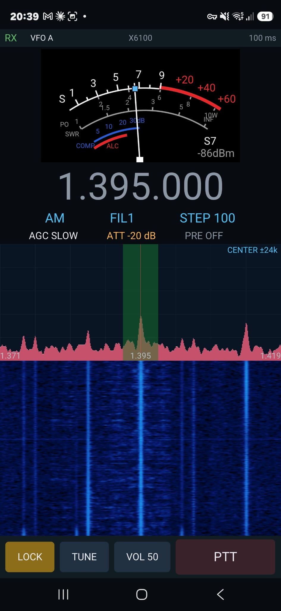
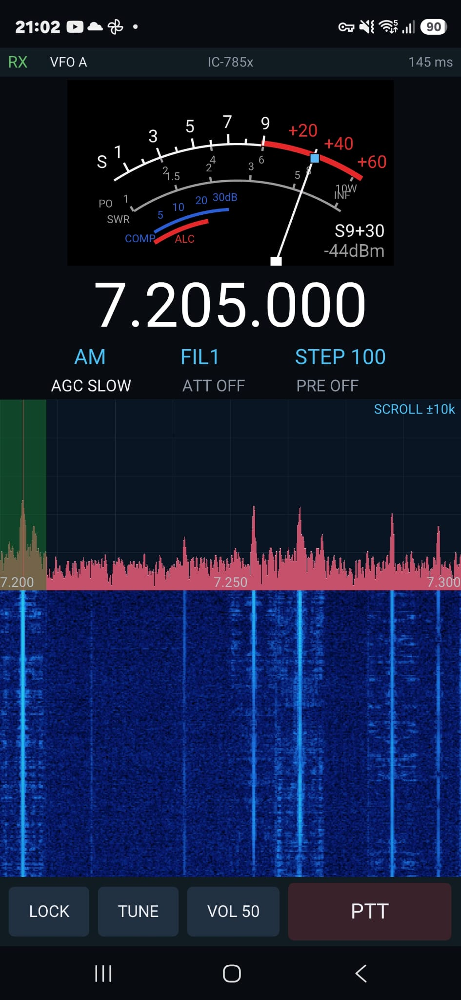

# libx6100_app

Remote client for Icom-protocol radios on the network (RS-BA1 / wfview UDP protocol), written in C with an LVGL user interface. It connects to a wfview server (wfserver) or straight to an Icom radio with built-in LAN. First target: the Xiegu X6100 via wfserver.

Status: working on Android and the Linux desktop against an X6100 (wfserver) and an IC-7851 (built-in LAN): RX, TX, scope, waterfall, meter and basic controls.

<p>


</p>

*Left: X6100 via wfserver, 1.395 MHz AM. Right: IC-7851 over its own LAN port, 7.205 MHz AM.*

## Features

- Connects to a wfview server or an Icom LAN radio over UDP: host name or IPv4, control port, username, password. The CI-V and audio ports are taken from the radio's announcement.
- Android: up to 16 saved connections on the connect page. Pick one to fill the form; Save keeps the form under its name (the same name replaces, a new one adds), Delete removes the picked one. The single profile from before becomes the first entry, named after its host.
- The rig is identified from its Transceiver ID reply and matched to the wfview `.rig` file with the same CI-V address. An unknown model is a hard error.
- RX audio: LPCM 8/16 bit, µ-law, ADPCM and Opus, mono or stereo. Mono rigs play on both channels. Stereo (Icom: main left, sub right): with dual watch main left and sub right; with a single receiver (right channel silent for 0.3 s) main on both. Rigs with dual watch: by default the selected receiver on both sides, following MAIN / SUB (2026-11-20); the rig-name menu can also give main left / sub right, or main or sub on both sides.
- Frequency: a tap on a digit's upper / lower half adds / takes one there, a long press opens the keypad; < and > beside it step (repeating while held), << and >> above them a band down / up (round, to the band's last frequency; 2026-11-21). Band button (the rig file's bands, the last frequency per band kept), the step kept per mode, FIL long press: the width of that filter (Filter Width), SQL: the squelch slider. PWR beside the meter (rigs with RF Power): the rig's RF power in %, amber under 10 %, a tap the slider (2026-11-20).
- Audio watch: NO AUDIO in the status bar when no audio packets came for 2 s, NO OUTPUT when they come but the phone plays none; a lost link (also 5 s without audio) is connected again by itself after 2 s.
- Split: while transmitting the frequency, mode and band show the TX side (2026-11-20). SPLIT in the AGC row (dim off, amber on, a tap switches it; always there on a rig with Split/Duplex, so the row does not shift), SPLIT TX with the frequency and mode of the other VFO / receiver in amber at the top left of the scope, as x6100_trx (under the sub line while that shows; 2026-11-20). Status bar: the receiver / VFO as the rig has it (MAIN / SUB on the 785x, 7760, 7610; MAIN A ... SUB B on the 9700; VFO A / B on one-receiver rigs; SPLIT added), a tap chooses (VFO Main/Sub Band, VFO A / B Select); UTC date and time. VOL: a short tap mutes RX and TX (silence in place of the mic), a long press the volume. Scope markers as x6100_trx: red main / A, green sub / B, yellow TX with split, dashed with a letter tag each in its colour (stacked T, M, S on one column, as the IC-7851), for 10 s after a change also through the waterfall, << / >> at the edge when out of view.
- Dual watch (rigs with two receivers and VFO Dual Watch in the rig file): DW in the AGC row (dim off, amber on; a tap switches it on the rig); while on, the big frequency is the active receiver (tagged MAIN or SUB) and the other one is on a line over the top left of the spectrum (SUB 14.074.000 USB). A tap on that line makes it the active one on the rig, with the scope; tuning, mode and filter then go there.
- TX audio: Opus, PCM16, PCM8, µ-law and ADPCM (mono), from the phone or desktop microphone. Android: per connection the microphone (Phone, or Bluetooth headset: the session then runs in call mode with the headset as the call device, RX over the call link too) and a mic gain of 100-400 %; while keyed the PTT button shows the mic peak (TX -9 dB, TX CLIP). The rig's DATA OFF MOD is set to its LAN input while connected and put back at the disconnect (per connection, on by default; from the rig file's Data Off Mod Input).
- Spectrum and waterfall from the radio's scope data:
  - tap to tune to a point, drag sideways to tune by steps
  - span chooser; long press switches centre / fixed
- Multi-scale analog meter as in libx6100 `x6100_trx`: S / Po, SWR, COMP and ALC arcs, with the same needle ballistics (80 ms attack, 900 ms release) and peak hold.
- Controls: frequency (keypad entry, checked against the rig file bands), tuning step, mode, filter, AGC, preamp, attenuator, scope span and mode, frequency lock, volume.
- Only the controls the rig file defines are shown. AGC names follow the rig: Icom FAST / MID / SLOW, X6100 FAST / AUTO / SLOW.
- TX: hold-to-talk PTT, the ATU button with the rig's tuner state (ATU ? not known yet, ATU OFF, ATU ON green, TUNING amber; no button for a rig whose rig file has no tuner, as the IC-9700; short press: in / out, also without TX; long press: a tune cycle), PTT time-out (as wfview, 30–999 s). RX audio is muted on the phone while keyed.
- The rig on / off: tap the rig name at the top, Power on or Power off (asks again). While a rig in standby gives no state, the "reading radio state" overlay has a Power on button. Works from standby when the rig keeps its LAN alive (its power on over LAN setting); CI-V 18 01 / 18 00 to the address from the login, as wfview does. Native console: `power on|off`.
- PTT safety guards:
  - PTT is released on finger up, on a lost press, on app pause or loss of the window, on a lost microphone, on link loss, on disconnect, and on a missing UI heartbeat.
  - When the app disconnects while keyed, PTT off is sent straight to the rig.
- Android: foreground service with a low-latency Wi-Fi lock, so audio keeps running with the screen off. Audio follows headphone and Bluetooth changes without a reconnect.

## Targets

| Target | Platform | State |
|---|---|---|
| `native` | Linux desktop (SDL2), test mode with text output and commands | working |
| `android-arm64` | Android 10 (API 29) and later, portrait | working |
| `x6100` | Xiegu X6100 as a control head (ARMv7, glibc) | planned |

### X6100 as a control head

The `x6100` target runs on the X6100 itself, with its baseband left off. The X6100 then acts as a hardware control head for a remote Icom, reached through wfserver or the radio's built-in LAN:

- **Display:** the same `ui/` operating screen on the 800 × 480 display, in landscape as `x6100_trx`.
- **Audio:** remote RX audio on the X6100's own speaker and headphone output, its microphone feeding remote TX, through ALSA on the X6100 codec.
- **Front panel:** VFO knob, encoders, keys and PTT through libx6100's input handling, mapped onto the same session controls.
- **Baseband:** never started. The X6100's own RF side stays idle and does not transmit.

## Building

Requirements:

- GNU make and a C11 compiler.
- **native:** SDL2 development files.
- **Android:** Android NDK (30.0.16248370), SDK platform 36, build-tools 37.0.0 and a JDK (javac). No Gradle needed.
- **X6100:** zig.

```
make TARGET=native
make TARGET=native test
make TARGET=native preview
make TARGET=android-arm64 apk
make TARGET=x6100
make DEBUG=1 TARGET=native
```

Toolchain paths come from the environment or a local `config.mk` (copy `config.mk.example`, not committed). A missing signing keystore is created on the first `apk` build.

`make TARGET=native preview` builds `ui-preview`, which renders the operating screen with made-up data to a PPM file:

```
./build/native/ui-preview /usr/share/fonts/truetype/DejaVuSans.ttf out.ppm 1080 2400 [mode|keypad|tx]
```

The native test mode:

```
./build/native/radio <host> <control-port> <user> <password> [client-name] [rx-codec] [rx-rate] [latency-ms] [tx-codec] [tx-rate]
```

## Deviations from wfview

wfview main is the reference for protocol, timing and behaviour. Where this client differs, on purpose:

1. IPv4 only.
2. Link loss after 15 s without a packet on the control stream, or on the CI-V stream once open (wfview's own server value), or when the radio closes a stream. Audio alone does not keep the link: an IC-7851 dropped control and CI-V and went on sending audio. PTT is released locally.
3. An unknown model is a hard error.
4. "Radio not responding!" is shown after 20 are-you-there attempts.
5. AGC Status is read at start-up and after each set.
6. Scope Span is read at start-up and after each set.
7. µ-law TX uses the 16-bit segment ends. wfview `audioconverter.cpp` uses the 13-bit ends on 16-bit samples, which drives most samples into the top segments. To be reported upstream.
8. RX audio is muted on the client while keyed (radio monitor / RX audio during TX).
9. Disconnect: the sockets stay open up to 1 s after the shutdown, the radio's retransmit requests are answered and the disconnect goes out 3 times on each stream; the token is removed whenever the login took, also without streams. wfview sends all once and closes, which left an IC-7851 holding the session for about 90 s.
10. A radio busy without another client (our own earlier session still closing) is logged out of and into again, at least 1 s apart, up to 10 times.
11. RX Mode and RX Frequency (IC-9700: Selected / Unselected Freq and Mode) are polled at High at the least (the rig files have Medium): a mode, DATA or filter change made on the rig, or the sub's frequency (no broadcast for the sub), showed only after several seconds. And a change of the active receiver (VFO Main/Sub Band) asks both receivers' frequency and mode at once.
12. No audio data for 5 s while control and CI-V run (with the rig file in, not around TX) counts as a lost link: "No audio from the radio". The app and x6100_trx connect again 2 s after a lost link (the new session first; the old stays until that works).
13. RX audio dropped as late (the ping delay estimate, as wfview) for 1 s without a break: the estimate starts afresh. Stuck high (a step of the rig's clock in its ping stamps, a stall) it dropped all audio for up to 20 s, now and then until a new connect. The status bar shows LATE while audio is dropped this way.
14. Android: the playback stream is watched (2026-11-20): one that failed to reopen is tried again each second, one whose callback has not run for 1 s while connected is reopened (NO OUTPUT now and then, until a reconnect).
15. TX refused by the server (wfserver gives TX audio to the first client only: wfview still connected): the PTT button says TX IN USE. After a reconnect that gets no TX where the connection had it (the old session still held it at wfserver), the app connects once more 3 s later, at most 3 times (2026-11-20).

## To do

- Clear connection errors instead of a silent `connecting`: host name not resolvable, no reply to the login within a few seconds, login refused (with the reason).
- Two-receiver rigs (IC-785x, IC-7610, IC-7760): show the sub receiver as VFO B.
- Spectrum scaling per rig (reference level / dB scale).
- Tuning steps from the rig file's `Tuning Steps` section (now a fixed list).
- More controls: RF gain, NB / NR, split, VFO B.
- `x6100` control-head target (see above).

## References

- [wfview](https://github.com/wf-group/wfview), branch main: protocol, timing and rig file format.
- [libx6100](https://github.com/roelandjansen/libx6100): X6100 support, `contrib/wfview/X6100.rig`, meter design (`tools/x6100_trx.c`).

## Licence

GPL-3.0-or-later. See `LICENSE`.

Each source file carries:

```c
// SPDX-License-Identifier: GPL-3.0-or-later
```

Third-party code keeps its own licence and copyright notices:

- LVGL 9.2.2: MIT
- Opus 1.5.2: BSD
- adpcm-xq: BSD
