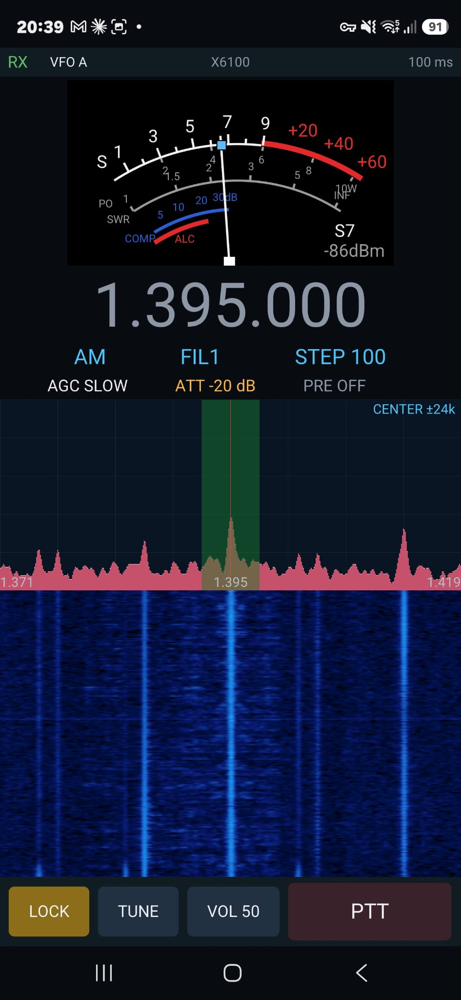
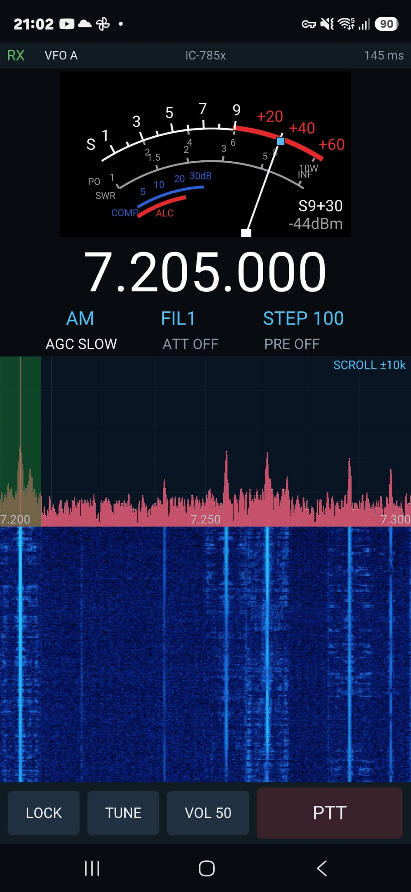

# libx6100_app

Remote client for Icom-protocol radios on the network (RS-BA1 / wfview UDP protocol), written in C with an LVGL user interface. It connects to a wfview server (wfserver) or straight to an Icom radio with built-in LAN. First target: the Xiegu X6100 via wfserver.

Status: working on Android and the Linux desktop against an X6100 (wfserver) and an IC-7851 (built-in LAN): RX, TX, scope, waterfall, meter and basic controls.

<p>


</p>

*Left: X6100 via wfserver, 1.395 MHz AM. Right: IC-7851 over its own LAN port, 7.205 MHz AM.*

## Features

- Connects to a wfview server or an Icom LAN radio over UDP: host name or IPv4, control port, username, password. The CI-V and audio ports are taken from the radio's announcement.
- The rig is identified from its Transceiver ID reply and matched to the wfview `.rig` file with the same CI-V address. An unknown model is a hard error.
- RX audio: LPCM 8/16 bit, µ-law, ADPCM and Opus, mono or stereo. Mono rigs play on both channels.
- TX audio: Opus, PCM16, PCM8, µ-law and ADPCM (mono), from the phone or desktop microphone.
- Spectrum and waterfall from the radio's scope data:
  - tap to tune to a point, drag sideways to tune by steps
  - span chooser; long press switches centre / fixed
- Multi-scale analog meter as in libx6100 `x6100_trx`: S / Po, SWR, COMP and ALC arcs, with the same needle ballistics (80 ms attack, 900 ms release) and peak hold.
- Controls: frequency (keypad entry, checked against the rig file bands), tuning step, mode, filter, AGC, preamp, attenuator, scope span and mode, frequency lock, volume.
- Only the controls the rig file defines are shown. AGC names follow the rig: Icom FAST / MID / SLOW, X6100 FAST / AUTO / SLOW.
- TX: hold-to-talk PTT, ATU tune (long press), PTT time-out (as wfview, 30–999 s). RX audio is muted on the phone while keyed.
- PTT safety guards:
  - PTT is released on finger up, on a lost press, on app pause or loss of the window, on a lost microphone, on link loss, on disconnect, and on a missing UI heartbeat.
  - When the app disconnects while keyed, PTT off is sent straight to the rig.
- Android: foreground service with a low-latency Wi-Fi lock, so audio keeps running with the screen off. Audio follows headphone and Bluetooth changes without a reconnect.

## Targets

| Target | Platform | State |
|---|---|---|
| `native` | Linux desktop (SDL2), test mode with text output and commands | working |
| `android-arm64` | Android 10 (API 29) and later, portrait | working |
| `x6100` | Xiegu X6100 as a control head (ARMv7, glibc) | planned |

### X6100 as a control head

The `x6100` target runs on the X6100 itself, with its baseband left off. The X6100 then acts as a hardware control head for a remote Icom, reached through wfserver or the radio's built-in LAN:

- **Display:** the same `ui/` operating screen on the 800 × 480 display, in landscape as `x6100_trx`.
- **Audio:** remote RX audio on the X6100's own speaker and headphone output, its microphone feeding remote TX, through ALSA on the X6100 codec.
- **Front panel:** VFO knob, encoders, keys and PTT through libx6100's input handling, mapped onto the same session controls.
- **Baseband:** never started. The X6100's own RF side stays idle and does not transmit.

## Building

Requirements:

- GNU make and a C11 compiler.
- **native:** SDL2 development files.
- **Android:** Android NDK (30.0.16248370), SDK platform 36, build-tools 37.0.0 and a JDK (javac). No Gradle needed.
- **X6100:** zig.

```
make TARGET=native
make TARGET=native test
make TARGET=native preview
make TARGET=android-arm64 apk
make TARGET=x6100
make DEBUG=1 TARGET=native
```

Toolchain paths come from the environment or a local `config.mk` (copy `config.mk.example`, not committed). A missing signing keystore is created on the first `apk` build.

`make TARGET=native preview` builds `ui-preview`, which renders the operating screen with made-up data to a PPM file:

```
./build/native/ui-preview /usr/share/fonts/truetype/DejaVuSans.ttf out.ppm 1080 2400 [mode|keypad|tx]
```

The native test mode:

```
./build/native/radio <host> <control-port> <user> <password> [client-name] [rx-codec] [rx-rate] [latency-ms] [tx-codec] [tx-rate]
```

## Deviations from wfview

wfview main is the reference for protocol, timing and behaviour. Where this client differs, on purpose:

1. IPv4 only.
2. Link loss after 15 s without any packet on any stream (wfview's own server value). PTT is released locally.
3. An unknown model is a hard error.
4. "Radio not responding!" is shown after 20 are-you-there attempts.
5. AGC Status is read at start-up and after each set.
6. Scope Span is read at start-up and after each set.
7. µ-law TX uses the 16-bit segment ends. wfview `audioconverter.cpp` uses the 13-bit ends on 16-bit samples, which drives most samples into the top segments. To be reported upstream.
8. RX audio is muted on the client while keyed (radio monitor / RX audio during TX).

## To do

- Clear connection errors instead of a silent `connecting`: host name not resolvable, no reply to the login within a few seconds, login refused (with the reason).
- Two-receiver rigs (IC-785x, IC-7610, IC-7760): show the sub receiver as VFO B.
- Spectrum scaling per rig (reference level / dB scale).
- Tuning steps from the rig file's `Tuning Steps` section (now a fixed list).
- More controls: RF gain, NB / NR, split, VFO B.
- `x6100` control-head target (see above).

## References

- [wfview](https://github.com/wf-group/wfview), branch main: protocol, timing and rig file format.
- [libx6100](https://github.com/roelandjansen/libx6100): X6100 support, `contrib/wfview/X6100.rig`, meter design (`tools/x6100_trx.c`).

## Licence

GPL-3.0-or-later. See `LICENSE`.

Each source file carries:

```c
// SPDX-License-Identifier: GPL-3.0-or-later
```

Third-party code keeps its own licence and copyright notices:

- LVGL 9.2.2: MIT
- Opus 1.5.2: BSD
- adpcm-xq: BSD
